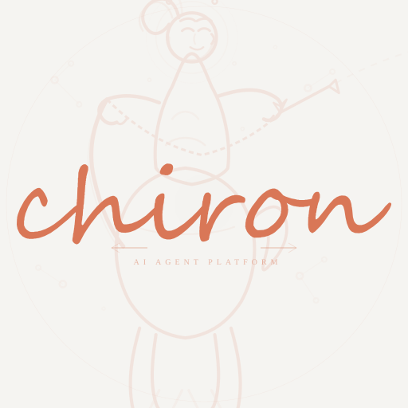

  

  <h1></h1>
  
  
<b>多租户 AI Agent 平台</b> 

  

    
    
  

---

## 为什么是 Chiron

你要一个独立运行在 windows 上的 Agent ? [Chiron-desktop](https://github.com/JulyZ0/chiron-desktop)

大多数 Agent 框架在单进程 demo 里都很好用。

真正难的是第二件事：**当你要把它交付给一个企业或组织时**。

[Chiron Server](https://github.com/Athenavi/chiron-server) 

## 许可

[MIT](LICENSE)
